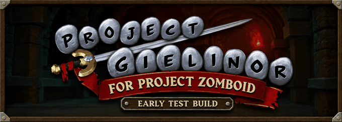

# Project Gielinor



Project Gielinor brings the world of Old School RuneScape into Project Zomboid.

We're building a survival experience where you can explore familiar towns, gather resources, develop skills and equip RuneScape gear while facing Zomboid's hunger, injuries, weather and zombies.

**[Get the mod on Steam Workshop](https://steamcommunity.com/sharedfiles/filedetails/?id=3821895054)**

---


> **Early test build for Project Zomboid Build 42.**
>
> Expect bugs, unfinished features and visual glitches. Start a new world after each update. We haven't tested compatibility with other mods.
>
> The vision below describes where we're taking the project; some systems remain planned or incomplete.

---


We want Gielinor to feel like a world you can live in, explore and struggle to survive.

- **A familiar world.** Explore RuneScape's towns, wilderness and landmarks for shelter and supplies.
- **RuneScape progression.** Gather resources, develop skills and craft equipment to help you survive.
- **Equipment worth finding.** Discover RuneScape weapons, armour and tools with useful roles in survival.
- **The inhabitants of Gielinor.** Encounter RuneScape creatures and wildlife with behaviours suited to the world.
- **Zomboid survival.** Manage hunger, injuries, exhaustion and weather while keeping zombies at bay.

---


- Project Zomboid Build 42.
- [ZombieBuddy](https://steamcommunity.com/sharedfiles/filedetails/?id=3619862853), including its Java component. Follow the installation instructions on its Workshop page.
- An internet connection for the initial content build.

---


1. Subscribe to Project Gielinor on Steam Workshop and install ZombieBuddy's Java component.
2. Enable Project Gielinor, which also enables ZombieBuddy. Allow Project Gielinor to run Java code when ZombieBuddy prompts you. You only need to approve this once.
3. At the main menu, follow the prompt to build the content pack. The builder downloads about 190 MB of game files from the [OpenRS2 archive](https://archive.openrs2.org) and generates the content on your computer.
4. Allow several minutes for the build. When it finishes, the mods reload with the content pack enabled.
5. Start a new game and choose **Gielinor** at World Select, then choose a starting town.

Initial content generation and world loading can take a while.

The mod does not ship Jagex's game files. Keep downloaded files and generated content packs on your computer; please don't share or upload them.

---


Install ZombieBuddy's Java component on the server and use:

```ini
Mods=ZombieBuddy;ProjectGielinorContent;ProjectGielinor
Map=Gielinor
```

The server builds its content pack on the first start and after builder updates. Players must build their own pack from the main menu before joining.

---


If you'd like to see Project Gielinor grow, leave a thumbs up and add it to your favourites on [Steam Workshop](https://steamcommunity.com/sharedfiles/filedetails/?id=3821895054). You can also star this repository to help others find the source.

Share ideas, experiences and bug reports in the Workshop comments or [GitHub issues](https://github.com/Jawdi/project-gielinor/issues). For bugs, include the location, what happened, your Zomboid version and enabled mods. Screenshot or video links are welcome; include relevant logs when available.

---


This repository contains the [mod](mod/ProjectGielinor) and [content-builder](builder) source. Use the Workshop version to play.

The builder uses RuneLite's cache library to read a pinned OSRS cache. Downloaded game files and generated packs are not part of this repository. Third-party library notices ship in the builder jar's `META-INF/THIRD-PARTY-NOTICES.txt`.

---


Do not reupload or redistribute this mod, including modified versions, without our permission. Do not copy or reuse our code in other projects without asking us first. This includes mod packs that bundle our files; you may include the Workshop link in collections.

See [source code permissions](LICENSE.md) for the full terms. These permissions concern our code only; RuneScape content belongs to Jagex.

*Project Gielinor is a fan project with no affiliation with or endorsement from Jagex or The Indie Stone. Old School RuneScape and RuneScape are trademarks of Jagex Ltd.; Project Zomboid is a trademark of The Indie Stone.*
